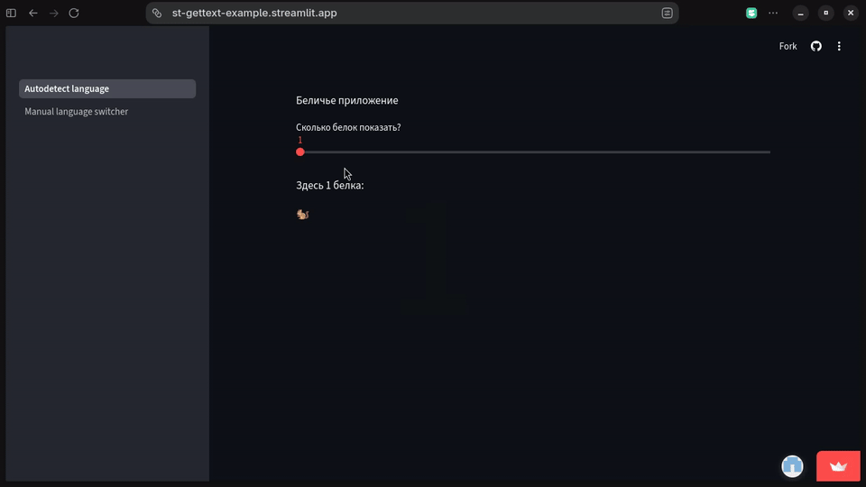

# streamlit-gettext

  

A Streamlit extension that makes it easy to localize your apps. It detects each user's preferred language from their browser and displays translated text accordingly. This avoids a common issue with gettext in Streamlit: when the browser language is detected only once at startup, all users may see the app in the same language.

The library does not translate text for you; providing translations is up to you.

When browser detection is active, `streamlit-gettext` checks each user's browser language whenever it translates a message. As a result, users of the same deployed app can see it in different languages. Calling `set_preferred_languages()` overrides browser detection for the current session; passing `None` or an empty iterable restores automatic detection.

Get started with the [complete setup guide](https://insolor.github.io/streamlit-gettext/quick_start/).

See a working app that uses `streamlit-gettext`: <https://github.com/dfint/package-build>

Feedback and suggestions are welcome.

Try the example application:

- [Source code](https://github.com/insolor/streamlit-gettext/tree/main/example)
- [Live app](https://st-gettext-example.streamlit.app) (it may take a moment to start)

Screencast of the app:

